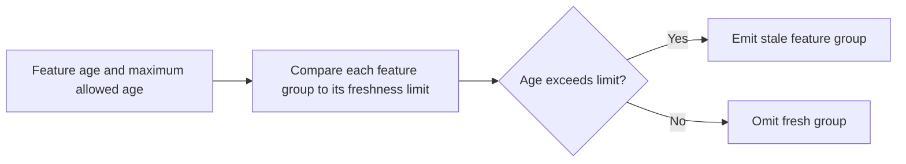

# Feature Store Freshness Monitor architecture

Checks ML feature freshness and flags stale feature groups before serving incidents.

## Operational boundaries

The documented run evaluates the bundled sample locally. Results depend on the quality and scope of the input. The demo makes no live infrastructure changes.
